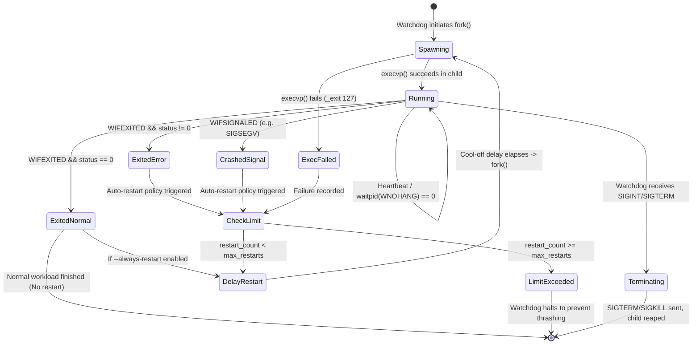

# System Architecture: Linux Process Watchdog and Auto-Restart System
**Course:** Operating Systems and System Programming (OSSP)  
**Academic Batch:** Batch 3  
**Target Environment:** Ubuntu Linux (GCC, POSIX.1-2008 Standard)

---

## 1. Architectural Overview

The **Linux Process Watchdog and Auto-Restart System** is a resilient, low-overhead systems supervision daemon designed to guarantee high availability for mission-critical Linux processes. It operates strictly in user space using POSIX system call primitives, ensuring that target child processes are monitored, failure states are captured and classified, crashes trigger controlled restarts, and shutdowns are performed cleanly without leaving zombie or orphan processes.

```
                              +----------------------------+
                              |         CLI / User         |
                              |  (Signals: SIGINT/SIGTERM) |
                              +--------------+-------------+
                                             |
                                             v
                             +-------------------------------+
                             |       Watchdog Supervisor     |
                             |           (Parent PID)        |
                             +---------------+---------------+
                                             |
                   +-------------------------+-------------------------+
                   |                         |                         |
                   v                         v                         v
     +---------------------------+  +-----------------+  +-------------------------+
     |   Process Manager Module  |  |  Logger Module  |  | Signal Handling Module  |
     |  (fork, execvp, waitpid)  |  | (Console & File)|  |   (sigaction, atomic)   |
     +-------------+-------------+  +-----------------+  +-------------------------+
                   |
     +-------------+-------------+
     | fork()      | waitpid()   |
     v             v             |
+---------------------+          |
|  Monitored Child    |----------+
|  Process (Worker)   |   Process Termination:
|     (Child PID)     |   - WIFEXITED (Code 0 vs Error)
+---------------------+   - WIFSIGNALED (SIGSEGV, etc.)
```

---

## 2. Core Modules and Responsibilities

The system is engineered in a modular C design with separation of concerns:

| Module | Source Files | Primary Responsibility | Key System Calls |
| :--- | :--- | :--- | :--- |
| **CLI & Entry** | `src/main.c` | CLI argument parsing, option validation, config dispatch. | `getopt_long()` |
| **Watchdog Engine** | `src/watchdog.c`, `src/watchdog.h` | Supervision loop, restart count tracking, backoff delay, decision matrix. | `sleep()`, `nanosleep()`, `getpid()` |
| **Process Manager** | `src/process_manager.c`, `src/process_manager.h` | Process creation, non-blocking state inspection, graceful shutdown, `/proc` parser. | `fork()`, `execvp()`, `waitpid()`, `kill()` |
| **Signal Handler** | `src/signal_handler.c`, `src/signal_handler.h` | Asynchronous signal interception, safe atomic state transition. | `sigaction()`, `sigemptyset()` |
| **Logger** | `src/logger.c`, `src/logger.h` | Dual-stream structured logging (color terminal and unbuffered text file). | `fopen()`, `fprintf()`, `fflush()` |

---

## 3. Process Lifecycle State Machine

The monitored process transitions through explicit lifecycle states:



---

## 4. Systems Programming Primitives

### 4.1 Process Creation: `fork()` & `execvp()`
- The parent calls `fork()`. If `fork() < 0`, error handling logs kernel failure.
- In child process (`pid == 0`), `execvp(argv[0], argv)` replaces the address space with the target binary.
- If `execvp()` fails (e.g., binary does not exist or lacks execute permission), the child immediately invokes `_exit(127)`. We use `_exit()` rather than `exit()` to prevent flushing or double-closing parent I/O buffers.

### 4.2 Non-Blocking Health Supervision: `waitpid(..., WNOHANG)`
- Instead of blocking the entire supervisor with `wait()`, the watchdog uses `waitpid(child_pid, &status, WNOHANG | WUNTRACED | WCONTINUED)`.
- **Return Values:**
  - `0`: Child process is running normally.
  - `> 0`: Child process terminated or changed state.
  - `-1`: Error condition. If `errno == EINTR`, the call was interrupted by a caught signal and resumes cleanly.

### 4.3 POSIX Termination Macro Analysis
When `waitpid()` returns the child PID, status macros decode the exact cause of death:
- `WIFEXITED(status)`: True if the child terminated normally (via `exit()` or returning from `main`).
  - `WEXITSTATUS(status)`: Yields the low-order 8 bits of the status argument. A value of `0` denotes success; non-zero denotes application error.
- `WIFSIGNALED(status)`: True if child was terminated by an unhandled signal (e.g. crash).
  - `WTERMSIG(status)`: Exact signal number (`SIGSEGV` = 11, `SIGABRT` = 6, `SIGFPE` = 8, `SIGKILL` = 9).
  - `WCOREDUMP(status)`: Identifies if a core dump file was produced by the kernel.

### 4.4 Graceful Termination and Zombie Prevention
A process that terminates remains in the process table as a **zombie** (`Z` state in `ps`) until its parent reads its exit status via `wait()` or `waitpid()`.
1. The watchdog continuously reaps terminated children via `waitpid()`.
2. During intentional shutdown (e.g., user presses `Ctrl+C`), the watchdog executes a two-phase cleanup:
   - **Phase 1 (Graceful):** Sends `kill(child_pid, SIGTERM)`. Polls with `waitpid(WNOHANG)` for up to 2 seconds.
   - **Phase 2 (Forced):** If the child is unresponsive, escalates to `kill(child_pid, SIGKILL)` and performs a blocking `waitpid(child_pid, &status, 0)` to guarantee child reaping.

### 4.5 Asynchronous Signal Safety
Signal handlers operate asynchronously in the context of the interrupted thread. Calling non-reentrant functions (such as `printf()`, `malloc()`, or `syslog()`) inside a signal handler causes race conditions and deadlocks.
- The system declares:
  ```c
  volatile sig_atomic_t g_shutdown_requested = 0;
  ```
- The `sigaction()` handler strictly writes `g_shutdown_requested = 1;` and returns immediately.
- The main event loop checks this flag using non-blocking slices (`nanosleep` 50ms intervals).

---

## 5. Linux `/proc` Virtual Filesystem Integration

The Linux `/proc` directory is a pseudo-filesystem mounted by the kernel, exposing kernel data structures for active processes.

### Inspected Nodes
- `/proc/<PID>/status`: Extracted metadata:
  - `Name`: Process binary name
  - `State`: `R` (running), `S` (sleeping), `D` (disk sleep), `Z` (zombie), `T` (stopped)
  - `PPid`: Parent Process ID
  - `VmRSS`: Resident Set Size (actual physical RAM occupied)
  - `Threads`: Number of POSIX threads in process
- `/proc/<PID>/cmdline`: Arguments passed to the process (null-byte delimited).

### Critical Systems Programming Limitation
> **Notice on Arbitrary Process Supervision:**  
> In POSIX/Linux, `waitpid()` and the `SIGCHLD` signal are strictly limited to direct child processes spawned by the calling process. An arbitrary third-party process cannot be reaped or waited on by an unrelated process. For unrelated processes, user space can only poll `kill(pid, 0)` or inspect `/proc/<PID>`. However, polling `/proc` cannot intercept the exact termination signal or prevent zombie states. Therefore, the Process Watchdog implements the robust parent-supervisor architecture.
