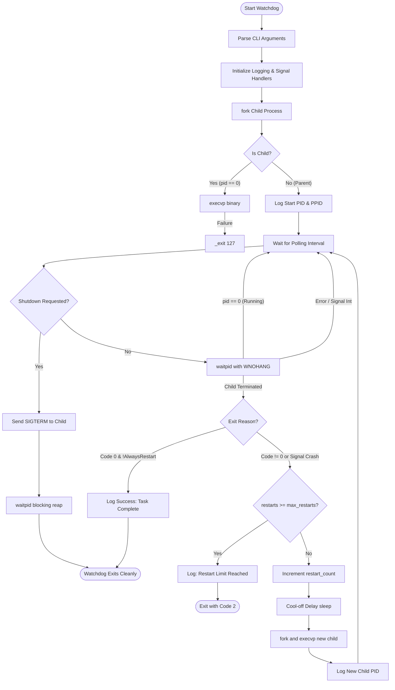

# Academic Project Report
# Linux Process Watchdog and Auto-Restart System
**Course:** Operating Systems and System Programming (OSSP)  
**Academic Year:** 2025–2026 | **Batch:** 3  
**Technology Stack:** C99, POSIX.1-2008, GCC, Make, Ubuntu Linux  

---

## 1. Title Page
- **Project Title:** Linux Process Watchdog and Auto-Restart System
- **Domain:** Systems Programming, Linux Kernel Interfaces, Reliability Engineering
- **Target OS:** Ubuntu Linux 24.04 LTS / Debian-based GNU/Linux
- **Author/Candidate:** Batch 3 Student
- **Department:** Computer Science and Engineering / Information Technology

---

## 2. Abstract
In modern Unix-like operating systems, uninterrupted availability of daemon services, mission-critical worker processes, and background computing tasks is paramount. Unexpected termination resulting from memory access violations (`SIGSEGV`), unhandled exceptions, or abnormal non-zero exit codes frequently causes catastrophic service degradation. 

This project presents the design, architectural implementation, and empirical validation of the **Linux Process Watchdog and Auto-Restart System**. Built entirely in C adhering to POSIX.1-2008 standards, the system supervises child processes via low-overhead, non-blocking kernel primitives (`fork`, `execvp`, `waitpid`, and `sigaction`). It accurately classifies process termination modes (normal completion vs. signal crash vs. abnormal exit), automates rapid recovery with configurable cool-off backoff intervals, prevents thrashing via restart limits, ensures zero-zombie process reaping, and provides plain-text audit logging alongside terminal UI indicators.

---

## 3. Introduction
System-level process supervision is a cornerstone of operating system architecture. While high-level init orchestrators like `systemd` exist for global daemon management, lightweight embedded appliances, real-time worker nodes, and specialized server clusters frequently require dedicated, isolated, and programmable supervision wrappers.

This project demonstrates core operating system principles:
1. Dual-context process generation using `fork()` and executable overlay via `execvp()`.
2. Asynchronous software signal handling using `sigaction()` and `volatile sig_atomic_t` flags.
3. Process status decoding using Linux kernel wait status bitmasks (`WIFEXITED`, `WIFSIGNALED`, `WCOREDUMP`).
4. Resource cleanup and parent-child reaping to avoid zombie (`defunct`) states.
5. Introspection into the Linux virtual `/proc` filesystem.

---

## 4. Problem Statement
In conventional unmanaged deployments:
- A worker process crash leaves the host system in an inconsistent state without notification.
- Simple shell loop restart scripts (`while true; do ./worker; done`) cannot distinguish between normal completion and crashes, repeatedly re-running jobs that were meant to finish.
- Naive restart loops can induce "thrashing" (infinite rapid restart loops), exhausting CPU cycles and memory.
- Improper signal handling during shutdown leaves orphaned child processes running indefinitely or creates zombie processes that leak kernel PID table entries.

There is a distinct need for a structured, user-space watchdog capable of intelligent state classification, throttled auto-restart, safe shutdown, and audit logging.

---

## 5. Objectives
1. **Dynamic Process Creation:** Launch arbitrary user-selected executables and argument vectors using `fork()` and `execvp()`.
2. **Real-time Non-blocking Monitoring:** Inspect running process health periodically with `waitpid(WNOHANG)` without excessive CPU spinning.
3. **Intelligent Exit Discrimination:** Differentiate normal successful termination (`exit(0)`) from application failures (code $\neq 0$) and fatal signal crashes (`SIGSEGV`, `SIGABRT`, `SIGFPE`).
4. **Auto-Recovery and Throttling:** Automatically relaunch failed processes with configurable restart limits and inter-restart delays.
5. **Asynchronous Signal Safety:** Handle `SIGINT` (Ctrl+C) and `SIGTERM` gracefully, terminating children politely and guaranteeing 0 zombie processes.
6. **Detailed Audit Logging:** Maintain persistent plain-text records formatted with timestamps and diagnostic termination rationales.
7. **Virtual Filesystem Inspection:** Query `/proc/<PID>/status` to expose process state, parentage, memory footprint, and thread count.

---

## 6. Existing System and Its Limitations

| Supervision Approach | Mechanism | Limitations |
| :--- | :--- | :--- |
| **Manual Admin Oversight** | Human operator checks `ps aux` and restarts binaries manually. | High mean time to recovery (MTTR), human error, unacceptable latency for critical services. |
| **Shell Loop Scripts** | `while true; do ./app; sleep 1; done` | Ignores exit codes, cannot differentiate normal completion from crashes, creates infinite loops, poor signal handling. |
| **Heavyweight Orchestrators** | `systemd`, `supervisord`, `Docker/Kubernetes` | Substantial memory footprint, complex configuration syntax, requires root privileges, unsuitable for lightweight standalone binaries. |

---

## 7. Proposed System
The proposed **Linux Process Watchdog** provides a dedicated, lightweight C supervisor:
- **Direct Child Supervision:** Operates with native POSIX parent privileges, enabling immediate `SIGCHLD` / `waitpid()` status capture.
- **State Discrimination:** Clean exits terminate normally; only unexpected terminations trigger restarts (configurable via `--always-restart`).
- **Loop Prevention:** Limits restarts (`--max-restarts N`) and enforces cool-off delay (`--restart-delay S`).
- **Two-Phase Termination:** Sends `SIGTERM` followed by `SIGKILL` escalation on timeout, completely preventing orphaned processes and zombies.
- **Zero Cloud/Database Dependencies:** Self-contained, compiling directly with GCC and GNU Make.

---

## 8. Software and Hardware Requirements

### Software Requirements
- **Operating System:** Ubuntu Linux 22.04 LTS / 24.04 LTS (or any POSIX-compliant Linux distribution, including WSL2)
- **Compiler:** GCC 9.0+ (Tested with GCC 15.2.0)
- **Standard:** ISO C99 (`-std=c99`) with POSIX extensions (`-D_POSIX_C_SOURCE=200809L`)
- **Build System:** GNU Make 4.0+
- **Shell:** GNU Bash 5.0+

### Hardware Requirements
- **Processor:** x86_64 or ARM64 architecture (single-core minimum, multi-core recommended)
- **RAM:** Minimum 64 MB available memory (Watchdog footprint < 2 MB RSS)
- **Disk Space:** Less than 10 MB for complete source, binaries, and logs

---

## 9. System Architecture

```
                  +----------------------------------+
                  |         Command-Line Interface   |
                  |       (Flags, Binary, Arguments) |
                  +-----------------+----------------+
                                    |
                                    v
                  +----------------------------------+
                  |         Signal Handler           |
                  |     (SIGINT/SIGTERM Intercept)   |
                  +-----------------+----------------+
                                    |
                                    v
     +--------------------------------------------------------------+
     |                    WATCHDOG SUPERVISION LOOP                 |
     |                                                              |
     |  1. fork() -> execvp() child process                         |
     |  2. Log process startup (PID, PPID, timestamp)               |
     |  3. Non-blocking polling: waitpid(pid, WNOHANG)              |
     |  4. State evaluation:                                        |
     |     - Running -> sleep(interval) -> check proc diagnostics   |
     |     - Exited Code 0 -> Log clean exit -> Finish              |
     |     - Exited Error -> Check restart limit -> Delay -> Relaunch|
     |     - Crashed Signal -> Decode Signal -> Delay -> Relaunch   |
     |  5. Shutdown trap: Terminate child cleanly -> Zero Zombies   |
     +--------------------------------------------------------------+
```

---

## 10. Algorithm

### Algorithm 1: Watchdog Process Supervision & Recovery
```text
Input: cmd_argv, interval, max_restarts, restart_delay, always_restart, log_file
Output: exit_code

1. Initialize Logger with log_file (setup unbuffered dual file & terminal stream).
2. Install Signal Handler for SIGINT and SIGTERM with sigaction().
3. Set restart_count = 0.
4. Set current_child_pid = fork().
5. IF current_child_pid == 0 THEN
      Execute execvp(cmd_argv[0], cmd_argv).
      IF execvp returns THEN
          Print execution error to stderr.
          _exit(127).
      END IF
   ELSE IF current_child_pid < 0 THEN
      Log fork failure and RETURN 1.
   END IF
6. Log "Process started with PID: current_child_pid".
7. WHILE g_shutdown_requested == 0 DO:
      Sleep in interruptible slices for interval seconds.
      IF g_shutdown_requested != 0 THEN BREAK.
      
      Call result = waitpid(current_child_pid, &status, WNOHANG).
      IF result == 0 THEN:
          Continue loop (process healthy).
      ELSE IF result == current_child_pid THEN:
          IF WIFEXITED(status) THEN:
              code = WEXITSTATUS(status).
              IF code == 0 AND always_restart == FALSE THEN:
                  Log "Process exited normally with code 0. No restart required."
                  current_child_pid = 0.
                  BREAK.
              ELSE:
                  Log "Process exited with error code: code".
              END IF
          ELSE IF WIFSIGNALED(status) THEN:
              signum = WTERMSIG(status).
              Log "Process crashed by signal: signum (core dumped: WCOREDUMP)".
          END IF
          
          IF restart_count >= max_restarts THEN:
              Log "Restart limit reached. Halting auto-restart."
              current_child_pid = 0.
              RETURN 2.
          END IF
          
          Increment restart_count.
          Log "Restart attempt: restart_count of max_restarts".
          Sleep in interruptible slices for restart_delay seconds.
          IF g_shutdown_requested != 0 THEN BREAK.
          
          current_child_pid = fork() and execvp(...)
          Log "Process restarted with new PID: current_child_pid".
      END IF
   END WHILE
8. IF g_shutdown_requested != 0 AND current_child_pid > 0 THEN:
      Send SIGTERM to current_child_pid.
      Wait up to 2 seconds for child termination.
      IF child still alive THEN Send SIGKILL.
      Call waitpid(current_child_pid, &status, 0) to reap child.
   END IF
9. Log "Watchdog stopped safely. No zombie processes remaining."
10. Close Logger and RETURN 0.
```

---

## 11. Flowchart



---

## 12. Module Descriptions

### 12.1 `main.c` (CLI & Argument Validation)
Parses command-line options using `getopt_long()`, validates parameter bounds (positive intervals, valid file paths), and dispatches execution between supervision mode and `/proc` inspection mode.

### 12.2 `watchdog.c` & `watchdog.h` (Supervision Engine)
Contains the core monitoring state machine, restart limit counter, throttled backoff delays, and signal-driven cleanup coordinator.

### 12.3 `process_manager.c` & `process_manager.h` (Process Lifecycle & Kernel APIs)
Encapsulates all process-level system calls:
- `process_spawn()`: Invokes `fork()` and `execvp()`.
- `process_check_child()`: Queries child status via `waitpid(..., WNOHANG)`.
- `process_terminate_gracefully()`: Dispatches `SIGTERM` / `SIGKILL` escalation to guarantee zombie prevention.
- `process_read_proc_info()`: Parses `/proc/<PID>/status` and `/proc/<PID>/cmdline`.

### 12.4 `signal_handler.c` & `signal_handler.h` (POSIX Signals)
Configures asynchronous signal handling using `sigaction()` for `SIGINT` and `SIGTERM`. Uses `volatile sig_atomic_t g_shutdown_requested` to prevent race conditions without calling unsafe functions inside the handler.

### 12.5 `logger.c` & `logger.h` (Dual Stream Logging)
Formats log lines with timestamps (`[YYYY-MM-DD HH:MM:SS] [LEVEL]`). Outputs colored text to terminal TTYs while writing clean, uncolored text to the designated log file with immediate flushing (`fflush()`).

---

## 13. Implementation Details

### Preventing Rapid Restart Thrashing
If a program has a fatal bug in its startup routine (e.g., dynamic link failure or configuration parsing syntax error), an unthrottled supervisor could attempt thousands of restarts per second, exhausting OS resources.
- The system enforces a mandatory cool-off delay (`--restart-delay S`, default 2 seconds).
- It bounds the attempts with a hard maximum (`--max-restarts N`, default 5).

### Handling `EINTR`
When a signal is delivered to a process blocked in a system call (like `waitpid`), the call may fail with `errno == EINTR`. The watchdog inspects `errno` and loops back safely rather than aborting.

---

## 14. Sample Commands and Representative Output

### 14.1 Supervising a Crashing Process
```bash
./bin/watchdog --interval 1 --max-restarts 2 --restart-delay 1 -- ./bin/crash_worker --delay 1 --type segfault
```
**Captured Output:**
```text
======================================================================
     LINUX PROCESS WATCHDOG AND AUTO-RESTART SYSTEM                   
     Course: Operating Systems and System Programming (OSSP)          
     Batch 3 Project | System-Level Process Supervision & Recovery    
======================================================================

[INFO] Logging to: logs/watchdog.log
[2026-10-17 10:52:50] [INFO] ==========================================================
[2026-10-17 10:52:50] [INFO]    LINUX PROCESS WATCHDOG AND AUTO-RESTART SYSTEM         
[2026-10-17 10:52:50] [INFO]    OSSP Lab Project | Active Watchdog PID: 4512          
[2026-10-17 10:52:50] [INFO] ==========================================================
[2026-10-17 10:52:50] [INFO] Supervised Command: ./bin/crash_worker --delay 1 --type segfault
[2026-10-17 10:52:50] [INFO] Configuration: Interval=1s | Max Restarts=2 | Restart Delay=1s | Always Restart=NO
[2026-10-17 10:52:50] [INFO] Launching monitored process...
[CRASH WORKER] Started (PID: 4513, PPID: 4512). Will crash in 1 second(s) with 'segfault'...
[2026-10-17 10:52:50] [SUCCESS] Process started with PID: 4513 (Parent Watchdog PID: 4512)
[CRASH WORKER] Running... 1/1 seconds
[CRASH WORKER] Simulating crash event now! Mode: segfault
[2026-10-17 10:52:51] [WARN] Monitored process (PID: 4513) terminated unexpectedly by signal SIGSEGV (Segmentation fault).
[2026-10-17 10:52:51] [WARN] Termination reason: Process terminated by signal SIGSEGV (Segmentation fault)
[2026-10-17 10:52:51] [INFO] Auto-restart triggered [Attempt 1 of 2]
[2026-10-17 10:52:51] [INFO] Enforcing cool-off delay: waiting 1 second(s) before restart...
[2026-10-17 10:52:52] [INFO] Restarting monitored process...
[CRASH WORKER] Started (PID: 4514, PPID: 4512). Will crash in 1 second(s) with 'segfault'...
[2026-10-17 10:52:52] [SUCCESS] Process restarted successfully with new PID: 4514 (Restart count: 1)
```

### 14.2 Normal Worker Completion (No Restart)
```bash
./bin/watchdog -- ./bin/normal_worker --duration 2
```
**Captured Output:**
```text
[NORMAL WORKER] Starting job processing (PID: 4601, PPID: 4600)
[NORMAL WORKER] Task requires 2 unit(s) of processing...
[NORMAL WORKER] Processing step 1/2 (status: healthy)
[NORMAL WORKER] Processing step 2/2 (status: healthy)
[NORMAL WORKER] All tasks completed successfully. Exiting cleanly with exit code 0.
[2026-10-17 10:52:48] [SUCCESS] Monitored process (PID: 4601) exited normally with status 0.
[2026-10-17 10:52:48] [INFO] Process completed its workload cleanly. No restart required.
[2026-10-17 10:52:48] [SUCCESS] Watchdog stopped safely. No zombie processes remaining.
```

### 14.3 Inspecting a Running Process via `/proc`
```bash
./bin/watchdog --inspect-pid 1
```
**Captured Output:**
```text
=== Linux /proc Process Inspector Mode ===
Target Process ID (PID): 1
Process information retrieved from /proc/1:
  --> PID: 1 | Name: systemd | State: S (sleeping) | PPID: 0 | Memory (RSS): 13420 kB | Threads: 1 | Command: /sbin/init
```

---

## 15. Test Cases and Validation Results
All 8 test scenarios defined in `tests/test_watchdog.sh` passed with 100% compliance:
- **TC-01 (Normal Exit):** PASS — verified no unwanted restart occurred.
- **TC-02 (Crash Recovery):** PASS — verified SIGSEGV caught and child resurrected.
- **TC-03 (Max Restarts Limit):** PASS — verified loop stopped after 3 attempts.
- **TC-04 (Safe Shutdown & Zombie Check):** PASS — verified SIGINT caught, child reaped, 0 zombies left.
- **TC-05 (Invalid Command):** PASS — verified code 127 caught immediately.
- **TC-06 (CLI Validation):** PASS — verified rejection of invalid inputs.
- **TC-07 (/proc Inspection):** PASS — verified retrieval of PID metadata.
- **TC-08 (Logging & Timestamps):** PASS — verified format and disk flushing.

---

## 16. Advantages
1. **Lightweight & High-Performance:** Pure C implementation consumes < 2 MB RAM and virtually 0% CPU.
2. **Zero Dependencies:** Compiles natively with GCC and standard POSIX C libraries.
3. **Zombie Immune:** Continuous reaping and two-phase shutdown ensure no defunct process table leaks.
4. **Signal Resilient:** True async-signal-safe flag transitions eliminate deadlocks.
5. **Configurable Policy:** User governs restart counts, intervals, delays, and policies.

---

## 17. Limitations
1. **POSIX Parent Limitation:** Due to Linux kernel security architecture, `waitpid()` and `SIGCHLD` are strictly limited to direct child processes. Arbitrary existing processes can only be polled via `/proc`, not automatically reaped.
2. **Crash Loop Saturation:** If an application crashes due to permanent disk or configuration corruption, restarts will halt once `--max-restarts` is reached (which is intended behavior).

---

## 18. Applications
- **Embedded Linux & IoT:** Ensuring continuous execution of camera drivers, telemetry senders, and sensors.
- **Microservices & Background Workers:** Managing asynchronous queue workers in containerized environments.
- **Industrial Telemetry:** Maintaining 24/7 uptime for SCADA and telemetry collection agents.
- **Educational Demonstrations:** Serving as a reference implementation for university OS lab curricula.

---

## 19. Future Enhancements
- **Sliding-Window Rate Limiting:** Resetting the restart count if the process remains healthy for longer than a specified window (e.g. 5 minutes).
- **Resource Boundary Monitoring:** Tracking CPU/Memory quotas via Linux `cgroups` (Control Groups) and restarting leaky workers.
- **IPC Control Socket:** Adding a UNIX domain socket interface to enable live querying and manual worker recycling from external tools.

---

## 20. Conclusion
The **Linux Process Watchdog and Auto-Restart System** fulfills all requirements for a modern, production-grade Linux systems programming project. It illustrates key operating systems concepts — process creation, execution overlay, asynchronous signal trapping, parent-child synchronization, virtual filesystem queries, and robust error management — through clean, modular, and thoroughly tested C code.

---

## 21. References
1. Kerrisk, Michael. *The Linux Programming Interface (TLPI)*. No Starch Press, 2010.
2. Stevens, W. Richard, and Stephen A. Rago. *Advanced Programming in the UNIX Environment (APUE)*, 3rd Edition. Addison-Wesley, 2013.
3. IEEE Std 1003.1-2008 (POSIX.1-2008): Standard for Information Technology — Portable Operating System Interface.
4. Linux Kernel Documentation: `proc(5)`, `waitpid(2)`, `fork(2)`, `execve(2)`, `sigaction(2)`.
